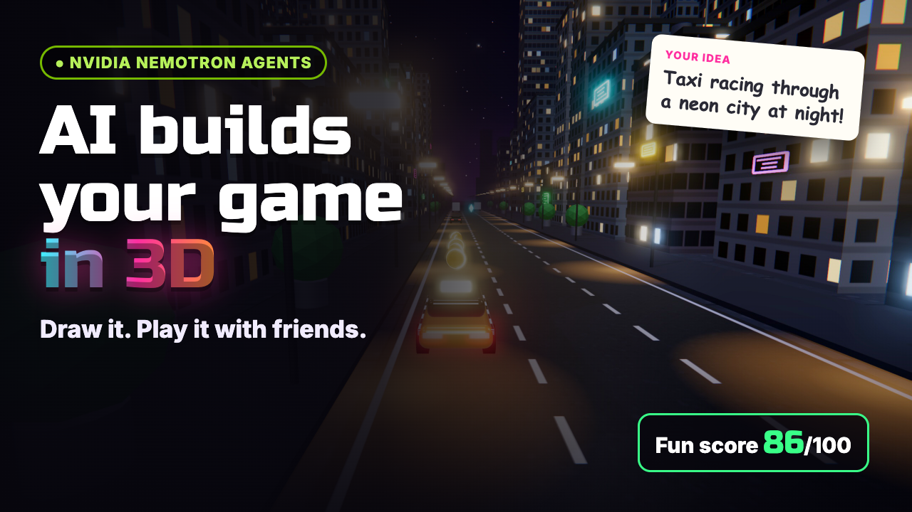
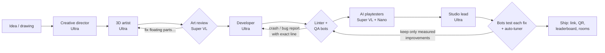

# ✏️🎮 Napkin Arcade

**Draw a game on a napkin — or describe it in one sentence. An AI game studio of NVIDIA Nemotron agents designs it, builds it in 3D, writes the code, playtests it with vision, and only ships it once it's fun. Then share a link and race your friends.**

[](https://youtu.be/aGX1owDcOKo)

- **Live app:** https://napkinarcade.revenuerush.in
- **Demo video (2:14):** https://youtu.be/aGX1owDcOKo
- **A game built in the video:** https://napkinarcade.revenuerush.in/play/d91b2502
- **Free arcade (no sign-in):** https://napkinarcade.revenuerush.in/arcade

Built for the **Nebius × NVIDIA Global AI Hackathon** — track: *Coding & Agentic Engineering* (agents that write, run and test code).

---

## What it does

1. **You give it an idea** — a photo of a sketch, a sentence, or both.
2. **A studio of agents builds a real 3D game** — characters, world, rules, three stages, power-ups and an ending.
3. **The studio tests its own work** — a linter and 15 bot players run the generated code; AI playtesters look at the actual screen and play it.
4. **It fixes what isn't fun** — the studio lead proposes changes, the bots measure each one, and only a measurable improvement ships.
5. **You play and share** — every game gets a link and QR code, a global leaderboard, keyboard + touch controls, and multiplayer rooms you join from a share link.

A typical game takes about two minutes and **about ten cents of AI**.

## The studio: NVIDIA Nemotron on Nebius Token Factory

Every model call goes to **Nebius Token Factory** (OpenAI-compatible API, `https://api.tokenfactory.nebius.com/v1`) at runtime, using four NVIDIA Nemotron models:

| Agent | Model | Job |
|---|---|---|
| 🎨 Art director | **Nemotron 3.5 Super VL** | Reads the drawing (characters, rules, handwritten notes); later **reviews renders of every 3D model with vision** and sends concrete fixes back |
| 🧠 Creative director | **Nemotron 3 Ultra** | Turns the idea into a game design: template, world, controls, entities, three stages, a twist, win/lose rules |
| 🧊 3D artist | **Nemotron 3 Ultra** | Builds characters and props from 3D primitives (a JSON model format), then rebuilds what the art director flags |
| 🧑‍💻 Developer | **Nemotron 3 Ultra** | Writes the complete game as a JavaScript module against the engine API; fixes bugs reported by QA |
| 👀 AI playtesters | **Nemotron 3.5 Super VL** + **Nemotron 3 Nano** | Personas (a 7-year-old, a grandpa) see real frames of the running game, choose each move, and Nano writes their notes |
| 🧭 Studio lead | **Nemotron 3 Ultra** | Reads bot telemetry, playtester notes and the code; proposes three fixes (tuning or code patches) |
| 🤖 QA bots | (no model) | 15 headless bots at three skill levels run the real code in a sandbox and measure wins, progress, deaths and length |

How the models are called (see [`server/llm.js`](server/llm.js)):

- Standard `chat/completions` requests; vision calls send the image as an `image_url` data URL.
- Reasoning is turned off with `chat_template_kwargs: { enable_thinking: false }` where speed matters (thinking models otherwise spend the whole token budget reasoning).
- Model names are resolved against `/v1/models` at startup (e.g. `nvidia/Nemotron-3-Ultra-550b-a55b`, `nvidia/Nemotron-3.5-Super-VL`, `nvidia/nemotron-3-super-120b-a12b`, `nvidia/NVIDIA-Nemotron-3-Nano-30B-A3B`).
- **Spending guardrails in code:** a cost ledger, a per-game cap ($1), a hard total cap, a per-hour build limit and per-user daily builds.

### The loop that makes it agentic



- **Self-healing code:** an [acorn-based linter](server/lint.js) catches syntax errors and undeclared variables instantly and quotes the exact failing line; smoke-test bots catch runtime crashes and gameplay bugs ("the player never moves", "reaching the end doesn't win"). Each report goes straight back to the developer.
- **Measured fun:** a fun score combines win rates at three skill levels (targets ~35% / 65% / 95%), how far players get, run length, early deaths and pickups. A built-in **auto-tuner** competes with the lead's ideas by easing every difficulty knob in the game's `TUNING`.
- **Vision in the loop, twice:** Super VL judges the 3D models from rendered images, and plays the finished game from screenshots.

## The engine

A purpose-built 3D runtime on [three.js](https://threejs.org) ([`public/engine3d/`](public/engine3d)):

- **12 world presets** (neon city, space, candy, volcano, underwater, synthwave…) with procedural textures, instanced scenery, sky shaders, weather, ocean
- **Lighting and post-processing:** ACES tone mapping, soft shadows, image-based reflections, bloom, vignette
- **3D model kit:** rounded boxes, wheels, stars, hearts… with physically based materials (car paint with clear coat, chrome, glass, neon glow) and part animations
- Particles, procedural sound effects, HUD, pause/mute/fullscreen, keyboard + touch
- **Bots** that plan lanes or sample safe moves, used both for QA and as an autopilot
- **Safety:** AI-written code only ever runs inside **sandboxed, opaque-origin iframes** in the browser — never on the server

Six hand-made showcase games double as templates for the developer agent and as the free arcade: Neon Cab Rush, Ring Rider, Star Pup Panic, Frost Fall, Meteor Mayhem and Reef Rush.

## Platform features

- **Email one-time-code sign-in** (no passwords); only members create games, with a daily build allowance
- **Free arcade** of polished games with **global leaderboards** and personal bests
- **Multiplayer rooms** over WebSockets: share a link, everyone lands in the lobby, same world seed, live rivals as ghost cars with name tags, live leaderboard and podium
- Landing page with a live 3D background and a replay of a real studio run

## Run it locally

Requirements: Node.js 20+ and a Nebius Token Factory API key.

```bash
git clone https://github.com/ramudevhub-90/NAPKIN-ARCADE.git
cd NAPKIN-ARCADE
npm install
echo "NEBIUS_API_KEY=your-key" > .env
npm start            # http://localhost:8787
npm test             # linter, scoring and auto-tuner tests
```

Without email settings, sign-in codes are printed in the server log (development only). Optional settings in `.env`: `HARD_CAP_USD`, `CAMPAIGN_CAP_USD`, `LIVE_RUNS_PER_HOUR`, `DAILY_BUILDS_PER_USER`, `MODEL_VISION` / `MODEL_DESIGNER` / `MODEL_DEVELOPER` / `MODEL_FAST`, and mail via `MAIL_PROVIDER=ses`, `SMTP_*` or `RESEND_API_KEY`.

## Deploy (AWS)

[`deploy/stack.yml`](deploy/stack.yml) is a CloudFormation stack: one small ARM EC2 instance (t4g.small) behind **Caddy** (automatic HTTPS), a Route 53 zone for the subdomain, SES email identity, and an IAM role; no SSH — installs run through Systems Manager. App settings live encrypted in SSM Parameter Store.

```bash
AWS_PROFILE=<profile> deploy/deploy.sh          # create/update the stack and ship the code
AWS_PROFILE=<profile> deploy/publish-game.sh <id> # copy a locally built game to the live site
```

Sign-in emails can be sent through another account's SES via a send-only role ([`deploy/ses-sender-role.yml`](deploy/ses-sender-role.yml)).

## Project layout

```
server/            Node.js server (no framework): studio pipeline, API, SSE, rooms, auth
  studio3d.js      the agent pipeline (design → art → review → code → QA → playtest → lead)
  prompts3d.js     agent prompts, engine API docs, model format
  llm.js           Token Factory client with cost ledger, caps and cache
  lint.js          static checks for AI-written game code
  rooms.js         multiplayer rooms (WebSocket)
  auth.js          email one-time codes, sessions, build limits
public/            web app: landing, studio, arcade, play pages
  engine3d/        3D runtime, worlds, models, effects, bots, sandboxed host, showcase games
video/             builds the demo video from the real app (Playwright + Polly + ffmpeg)
deploy/            AWS CloudFormation + deploy scripts
test/              unit tests
```

## License

[MIT](LICENSE) © 2026 Ramu Pal
